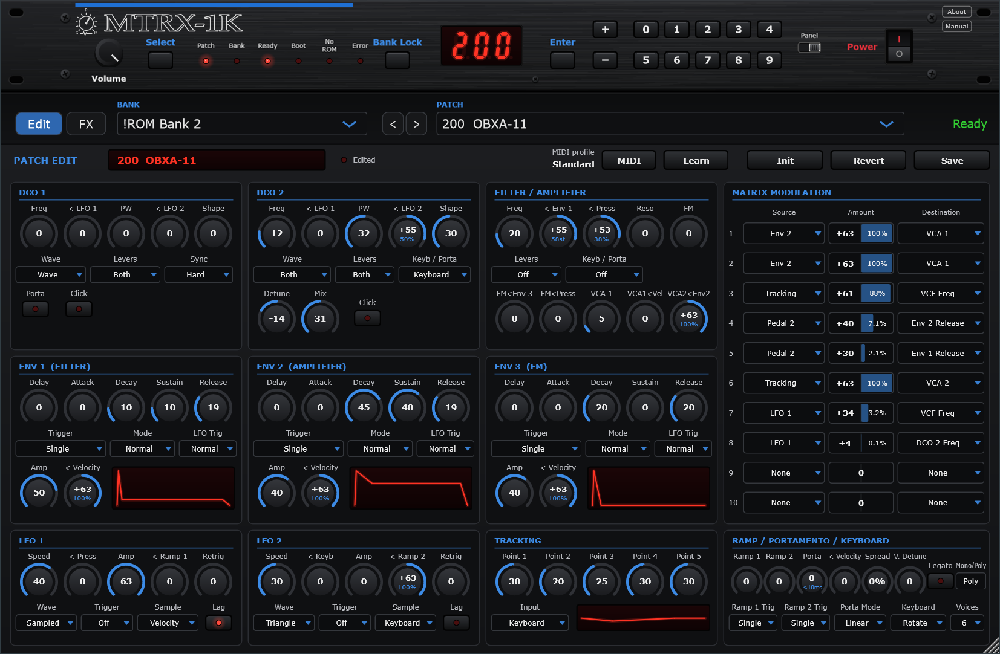
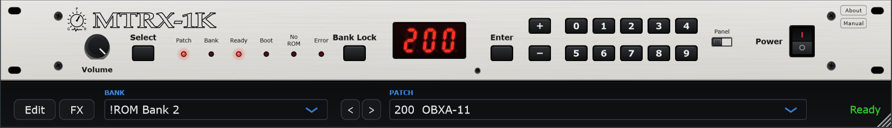
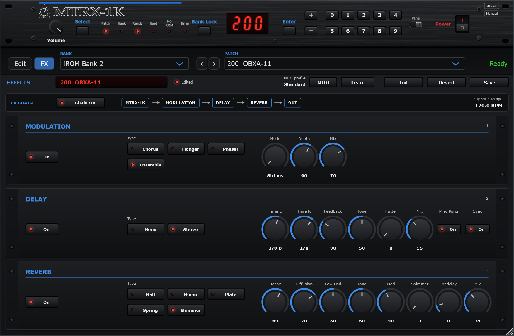

# MTRX-1K

A VST3 instrument and standalone app for Windows that plays and edits the sounds of a classic six-voice analogue synthesizer module of 1987, the Oberheim Matrix-1000, by running its original firmware on an emulated processor board that drives six models of its voice chip.

MTRX-1K is made by **GPR Music Project**. It is a modified version of [Retromulator](https://github.com/reales/retromulator) by discoDSP, reduced to its Matrix-1000 core and extended with a patch editor. It is free software under the GNU General Public License v3.

MTRX-1K is not affiliated with, endorsed by or connected to Oberheim. Oberheim and Matrix-1000 are trademarks of their owners and are named here only to say what the software emulates.



## Pictures

The rack panel, in the white finish, with the selectors of bank and patch under it:



The effects page, which the FX key opens in place of the editor: modulation, delay and reverb in a chain after the instrument.



## What it does

- Runs the original firmware (version 1.20) on an emulated 6809 board: timers, UART, sample and hold DAC, latches. The firmware calibrates the voices itself on the first start, and the factory banks are read out of the patch EPROM; a panel shows the progress of both. The results are kept, so later starts are immediate.
- Six voice models of the CEM3396 chip with band-limited oscillators, the three sync modes of the voice board, and 2x oversampling.
- A rack panel with display, keypad, bank lock and patch selection as on the instrument, in a black or a white finish.
- A patch editor the instrument never had: every parameter of a patch on one page, with the ten buses of the modulation matrix, envelope and tracking graphs, and the real depth of a modulation amount shown under its knob.
- Init, Revert and Save: a patch can be written to a position of the RAM bank or to a bank of your own. The RAM bank is copied to a backup folder before its first change.
- The 800 factory patches of banks 2 to 9 are read from the patch EPROM into bank files with their factory names.
- Every patch parameter is a host parameter that can be automated.
- MIDI learn: any patch parameter, the buses of the modulation matrix included, is assigned to a control of your keyboard by clicking it and moving the control. Whether the control sends control changes or NRPNs, and with 7 or 14 bit values, is taken from what arrives. Sets of assignments are kept as named profiles that can be saved, changed and deleted, and exported to a JSON file and imported from one, to keep them or pass them on. The map the plugin always had, one control change per parameter, is the profile "Standard"; "None" assigns nothing.
- 6, 12 or 24 voices, picked with the Voices selector of the editor. The firmware is not changed: for 12 or 24 voices MTRX-1K runs two or four complete instruments, firmware and voice board each, the way Matrix-1000 modules chained over MIDI play, and gives every note to one of them; everything else reaches all of them. In mono unison the first one plays alone, as a single Matrix-1000 does. Every patch sets the voices: those saved with it from the editor, or 6 for a patch without them, as the factory patches. The added instruments are rendered on threads of their own beside the host's audio thread, so the audio thread carries no more than with six voices and the latency stays the same; each instrument costs about 9% of one core of an i9-13900H.
- Both LFOs can follow the host tempo. A cycle of the firmware's LFO lasts a whole number of steps of 26.6 ms, so a division is met within a few percent, not exactly.
- A MIDI program change selects that position of the loaded bank.
- A Spread knob places the voices in the stereo field, from 0% (all in the middle, as the instrument with its one output) to 100%; voices one after another go to opposite sides, across all the instruments with 12 or 24 voices. A control of the keyboard can be assigned to it in the MIDI learn. Voices, Spread, V. Detune and Mono/Poly belong to the patch: they are kept with a patch saved from the editor, in a message of their own (F0 7D 4D 58 03 vv ss dd mm F7; version 02 without mm, from 0.9.7, and 01 without dd either, from 0.9.6, are still read) right after the patch in the bank file, which other editors and the instrument pass over; a patch without them plays with 6 voices, no spread, no detune, and mono only in Unison.
- A V. Detune knob moves the voices apart around the note, evenly, up to about 47 cents for the outermost: the detune firmware 1.20 has on controller 94, sent by the knob to every instrument, kept with the patch and assignable in the MIDI learn.
- A Mono/Poly selector next to Legato. With the keyboard mode Unison, Mono is the instrument's own unison (all six voices on one note) and Poly a polyphonic unison: every note on two voices, so 3 notes with 6 voices, 6 with 12, 12 with 24; the oldest note is let go when more are played. With Reassign or Rotate, Mono plays one voice, one note at a time, with the firmware's legato, portamento and low-note priority, and Poly is the instrument. The firmware is not changed: it plays Reassign and gets each note twice for the polyphonic unison, and plays unison with one of its six voices heard for the mono voice. Before a choice it shows what the instrument does with the keyboard mode. Assignable in the MIDI learn.
- Effects after the instrument, on a page of their own that the FX key opens in place of the editor: three racks in a row, modulation (a bucket-brigade chorus with modes I, II and I+II, ported from Ultramaster KR-106 without its noise; flanger, phaser, ensemble with strings, chorus and both), delay (mono, stereo and ping-pong tape echo, synced to the host tempo when asked) and reverb (hall, room, plate, a triple-spring reverb after [Selector Spring Reverb](https://github.com/jennyrave-sys/SELECTOR_SPRING_REVERB_VST) by jennyrave-sys, and a shimmer after [Shimmer-Reverb](https://github.com/Danial-k-f/Shimmer-Reverb) by Danial Kooshki: the zita-rev1 reverberator of the Faust library with two transposed layers, each by -24 to +24 semitones, fed back so that the tail climbs interval by interval). All but the chorus, the spring and the shimmer are MTRX-1K's own models. Each rack and the whole chain switch on and off, a mix sets the chain against the instrument's own sound, the volume comes after the effects, every change fades so that nothing clicks, and every control can be assigned in the MIDI learn. The effects are kept with the patch, in a message of their own after it in the bank file (F0 7D 4D 58 10 ... F7), and with the session; a patch without them plays with the chain off, the instrument alone.
- A window that can be resized, from 60% to 200% of its normal size, by its bottom right corner or the edges of the host's window. The layout keeps its proportions and is drawn again at the new size, so legends, knobs and the brushed panel stay sharp; the size is remembered, and a window that would not fit on the screen when the editor opens is made smaller.
- A Manual key on the panel opens the user manual, a PDF that the setup program installs next to the standalone app.

Where the original moves a pitch or a control voltage in audible steps, about 75 times a second, MTRX-1K joins the steps. Everything else is meant to behave as the instrument does, firmware quirks included: the LFOs are one per voice, portamento glides from the note a voice played last, and the keyboard mode "Reassign Rob" does not rob a voice in firmware 1.20.

## Status

Version 1.0.0 alpha 3, October 2026. Built and tested on Windows 11 as a VST3 in Cubase 15 and as a standalone app. The build files for other systems come from Retromulator and have not been tried with this version.

## Firmware

The firmware is not included and is not part of this repository. You need your own copy of:

- the 32 KB system EPROM of the instrument, firmware version 1.20;
- the 64 KB patch EPROM, for the factory patches of banks 2 to 9 (optional).

Put the two `.bin` files in `Documents\GPR Music Project\MTRX-1K\ROM`. They are recognised by their size and content, not by their name. The banks are kept next to that folder, in `Documents\GPR Music Project\MTRX-1K\Patch`, and the MIDI learn profiles in `Documents\GPR Music Project\MTRX-1K\MIDI`.

## Building on Windows

You need Visual Studio with the C++ desktop workload and its CMake tools (CMake 3.22 or later and Ninja).

```
git clone --recurse-submodules https://github.com/gprmusicproject/mtrx-1k
cd mtrx-1k
build_win.bat
```

JUCE 8.0.15 comes as a submodule in `Modules/JUCE`. The plugin and the app are written to `build\win-release\Retromulator_artefacts\Release`, as `VST3\MTRX-1K.vst3` and `Standalone\MTRX-1K.exe`. To install the plugin, copy the `MTRX-1K.vst3` folder to `C:\Program Files\Common Files\VST3` while the host is closed.

## The setup program

`installer\mtrx-1k.iss` is the script of a setup program for Windows, made with [Inno Setup](https://jrsoftware.org/isinfo.php) 6:

```
ISCC.exe installer\mtrx-1k.iss
```

It takes the built app and plugin from `build\win-release` and the user manual, `MTRX-1K_User_Manual_v<version>.pdf`, from the root of the checkout, and writes `build\installer\out\MTRX-1K_<version>_Setup.exe`. The setup puts the standalone app and the manual in `Program Files\GPR Music Project\MTRX-1K`, the plugin in `Program Files\Common Files\VST3\GPR Music Project`, makes the folders `ROM`, `Patch` and `MIDI` in `Documents\GPR Music Project\MTRX-1K`. It includes no firmware and no factory sounds. The compiled package of GPR Music Project also comes with GPR Music Project Signature, a bank of 41 sounds that is not part of this repository: when `GPR Music Project Signature.syx` is in the root of the checkout as the setup is built, the setup puts it in `Patch` unless a file of that name is already there, and the uninstaller takes it away only while it is as the setup put it. MTRX-1K is listed among the installed apps of Windows and removed from there; the uninstaller asks whether MIDI profiles and sounds are to be removed too. `/DTestRoot=<folder>` builds a setup that needs no administrator and installs under that folder, for trying it out. The pictures of the wizard are drawn by `installer\make_images.ps1`.

## What was changed

This is a modified version of Retromulator 1.8.0 (commit `c20db50` of github.com/reales/retromulator), changed by GPR Music Project in October 2026. The history of this repository shows every change. In short:

- **Build**: a CMake project for Windows (`CMakeLists.txt`, `cmake/`, `build_win.bat`) next to the Projucer project of Retromulator.
- **Product**: name, vendor and plugin identifiers of MTRX-1K; only the Matrix-1000 core is started. The other cores of Retromulator are still in the source tree and are compiled in.
- **Interface** (`source/plugin`): the rack panel (`RackPanel`), the patch editor (`EditPanel`), saving and bank handling, the session state of the editor, automatable parameters, program change, and the MIDI learn with its profiles (`MidiLearn`), and the scaling of the whole window.
- **Effects** (`source/fxLib`): the chain of three racks and its effects, written for MTRX-1K but for the chorus, the spring reverb and the shimmer, which come from the open-source projects listed under [Open-source code in the effects](#open-source-code-in-the-effects). The volume is applied after the effects (`jucePluginLib/processor`).
- **Emulation** (`source/matrixLib`): the three sync modes after the schematic of the voice board; the timer writes with which the firmware moves a pitch; joined pitch and control voltage steps; the height of the oscillator ramp through a pitch change; the DCO click; pacing of remote parameter edits so that held notes follow a knob; portamento rate 0 in unison; the LFO rates used for the tempo sync; two or four instruments side by side for 12 or 24 voices, and stereo outputs for spreading their voices; the polyphonic unison and the single mono voice.

## Open-source code in the effects

Three effects of the chain contain code from other open-source projects. Each is used under its licence, which is compatible with the GPL v3 of MTRX-1K; the notices that the MIT and STK-4.3 licences require are in [`installer/third_party_notices.txt`](installer/third_party_notices.txt), which the setup installs next to the app as `Third-party notices.txt`.

| Effect | Project and author | Licence | In MTRX-1K |
|---|---|---|---|
| Chorus | [Ultramaster KR-106](https://github.com/kayrockscreenprinting/ultramaster_kr106) by kayrockscreenprinting: `KR106Chorus.h`, `BBDFilter.h` | GPL v3 | `Chorus` in `source/fxLib/fxOwn.cpp` |
| Spring reverb | [Selector Spring Reverb](https://github.com/jennyrave-sys/SELECTOR_SPRING_REVERB_VST) by jennyrave-sys: the `SpringReverbEngine` | GPL v3 | `Spring` in `source/fxLib/fxOwn.cpp` |
| Shimmer | [Shimmer-Reverb](https://github.com/Danial-k-f/Shimmer-Reverb) by Danial Kooshki: the shimmer loop of its processor | MIT | `Shimmer` in `source/fxLib/fxOwn.cpp` |
| Shimmer, its reverberator | zita_rev1 of the [Faust](https://faust.grame.fr) libraries by Julius O. Smith III and Christopher Arndt, after zita-rev1 by Fons Adriaensen, generated with Faust and taken from Shimmer-Reverb | STK-4.3 (MIT-style) | `source/fxLib/fxZitaRev.h` |

What MTRX-1K changed:

- **Chorus**: ported without JUCE; the noise floor, the leakage noise, the clicks of the clock and the mains ripple of the original are left out; each side of the stereo sound has its own lines, so that the spread of the voices stays; mode II is deeper than measured on the instrument (2.4 ms instead of 1.71) so that it stands apart from mode I; mode I+II plays I and II at once on a second pair of lines instead of the fast vibrato of the instrument; a Mix control.
- **Spring reverb**: ported without JUCE, one engine a side as in the original; a soft limit at the input of each spring, because the feedback of the original can grow without end and stop the audio; Bass and Treble act by ±12 dB; the Mix law of the other racks.
- **Shimmer**: the grains of the original are replaced by a phase vocoder with phase locking, because grains fluttered and crackled as the feedback piled them up; the loop has more gain (feedback up to 0.7, layers raised by 1.8), so that the shimmer is heard, and it always dies away; layers C and D are left out; starting values chosen by GPR Music Project.
- **Reverberator of the shimmer**: only the user section of the file Faust generated; its architecture, metadata, user interface and the setters MTRX-1K does not use are left out.

Techniques from published work, implemented for MTRX-1K: the plate after Jon Dattorro, "Effect Design, Part 1: Reverberator and Other Filters" (J. Audio Eng. Soc., 1997); the phase locking of the shimmer's phase vocoder after Jean Laroche and Mark Dolson, "Improved Phase Vocoder Time-Scale Modification of Audio" (IEEE Trans. Speech and Audio Processing, 1999).

## The name and the symbol

"GPR Music Project", "MTRX-1K" and the GPR symbol drawn on the panel identify this product and its author. The licence of the code lets you change and redistribute the code; it does not give you the right to present a changed version as coming from GPR Music Project. If you publish a modified version, give it your own name and symbol.

## Where the code comes from

The two parts below are taken unchanged from the README of Retromulator 1.8.0, whose code this repository contains.

### How Retromulator differs from Gearmulator

Retromulator is built on top of the open-source emulation engines from [Gearmulator](https://github.com/dsp56300/gearmulator) by dsp56300. Gearmulator ships as standalone applications and open-source plugins built with CMake. Retromulator packages the same engines into a polished single-plugin experience using JUCE, with a unified rack-style UI, DAW state persistence, bank/patch browsing, focused on preset playing.

The emulation cores (dsp56300, mc68k, h8s, synthLib and all synth-specific libraries) are from Gearmulator. The DX7 emulation is ported from VDX7, a separate project (see Credits below). The OPL3 emulation uses Nuked OPL3 by Nuke.YKT. The SID emulation uses reSID by Dag Lem. The AY-3-8910 / YM2149 emulation uses Ayumi by Peter Sovietov. The JE-8086 and SC-88 family emulations are by Giulio Zausa. The Tracker core uses the Fasttracker 2 clone replayer by Olav Sorensen and the Schism Tracker player. The Akai S1000 sampler uses the SFZero module, an MIT-licensed JUCE sample engine maintained by discoDSP. The Wurlitzer 200A (OpenWurli) is a physical model fully ported by discoDSP. The Matrix-1000 emulation (6809 board and CEM3396 voice model) is by discoDSP. The synthLib device adapters that wrap each engine (SID, AY-3-8910, OpenWurli, OPL3 and Tracker), the bank and patch handling, the offline WAV / MP3 renderer and the host parameter pool are by discoDSP.

### Credits of Retromulator

- **[dsp56300](https://github.com/dsp56300)** — DSP56300 emulator, Virus TI / microQ / XT / Nord N2X engines, GPL v3
- All contributors to [github.com/dsp56300/gearmulator](https://github.com/dsp56300/gearmulator)
- **Giulio Zausa** — Roland JP-8000 (JE-8086) and SC-88 family emulation
- **chiaccona** — [VDX7](https://github.com/chiaccona/VDX7), cycle-accurate Yamaha DX7 emulation (HD6303R CPU, EGS, OPS), GPL v3
- **Nuke.YKT** — [Nuked OPL3](https://github.com/nukeykt/Nuked-OPL3), cycle-accurate YMF262 emulation, LGPL v2.1
- **Dag Lem** — [reSID](https://en.wikipedia.org/wiki/ReSID), cycle-accurate MOS 6581 / 8580 SID emulation, GPL v2
- **Lasse Öörni / Cadaver** — [GoatTracker](https://sourceforge.net/projects/goattracker2/) `.sng` / `.ins` format reference, GPL v2
- **Olav Sorensen** — [Fasttracker 2 clone](https://github.com/8bitbubsy/ft2-clone), XM / MOD replayer, BSD 3-Clause
- **Schism Tracker contributors** — [Schism Tracker](https://github.com/schismtracker/schismtracker), S3M / IT player, GPL v2
- **Peter Sovietov** — [Ayumi](https://github.com/true-grue/ayumi), AY-3-8910 / YM2149 emulation, MIT license
- **Timothy Lamb** — [Ym2149Synth](https://github.com/trash80/Ym2149Synth), voice engine and soft envelope firmware, GPL v3
- **Dominic Mazzoni** — [libresample](https://github.com/minorninth/libresample), sinc resampling, BSD 3-Clause / LGPL dual
- **Jean-Marc Valin** — [Speex](https://www.speex.org/) arbitrary-rate resampler, BSD 3-Clause
- **Steve Folta** — original [SFZero](https://github.com/stevefolta/SFZero) SFZ/SF2 sample player, MIT license
- **Leo Olivers** — SFZero JUCE module port
- **discoDSP** — [SFZero v3.0.0](https://github.com/reales/retromulator/tree/main/Modules/SFZero), 8-point sinc interpolation, Bliss format, extended opcode support, MIT license; synthLib device adapters, bank and patch handling, offline WAV / MP3 render and host parameter pool, Oberheim Matrix-1000 emulation, GPL v3
- **Joshua Price** — [OpenWurli](https://github.com/hal0zer0/openwurli) Wurlitzer 200A physical model

JUCE integration, UI, AAX/AU/VST3 plumbing is developed separately.

## License

MTRX-1K as a whole, with the changes made by GPR Music Project, is licensed under the **GNU General Public License v3.0**, see [LICENSE.txt](LICENSE.txt). It comes with no warranty. JUCE, in `Modules/JUCE`, is used under the **GNU Affero General Public License v3.0**, see its own LICENSE.md. The standalone app on Windows talks to ASIO drivers through the ASIO headers that come with JUCE, used under the **GPL v3**, one of the two licences Steinberg gives them under. ASIO is a trademark and software of Steinberg Media Technologies GmbH.

From the README of Retromulator, for the parts it contains ("this repository" there means Retromulator):

The emulation engine source code in this repository is licensed under the **GNU General Public License v3.0** — see [LICENSE.txt](LICENSE.txt). The SFZero module is licensed under the **MIT License** — see [Modules/SFZero/LICENSE](Modules/SFZero/LICENSE). The Nuked OPL3 engine is licensed under the **GNU Lesser General Public License v2.1**. The reSID engine is licensed under the **GNU General Public License v2.0**. The Ayumi engine is licensed under the **MIT License** — see [source/ayumiLib/AYUMI_LICENSE.txt](source/ayumiLib/AYUMI_LICENSE.txt). The Fasttracker 2 replayer is licensed under the **BSD 3-Clause License** — see [source/trackerLib/ft2/LICENSE](source/trackerLib/ft2/LICENSE). The Schism Tracker player is licensed under the **GNU General Public License v2.0** — see [source/trackerLib/schism/COPYING](source/trackerLib/schism/COPYING). The libresample engine is licensed under the **BSD 3-Clause License** — see [source/libresample/LICENSE-BSD.txt](source/libresample/LICENSE-BSD.txt). The Speex resampler is licensed under the **BSD 3-Clause License**. The LAME MP3 encoder is licensed under the **GNU Lesser General Public License v2** — see [source/lameLib/COPYING](source/lameLib/COPYING).
